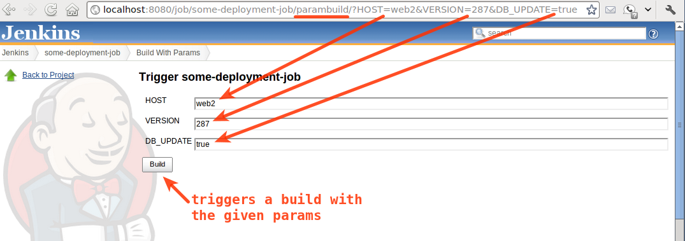

Build with Parameters Plugin
============================

Allows the user to provide parameters for a build in the url, prompting for confirmation before triggering the job.

The plugin exposes `$JENKINS/job/$JOB/parambuild` url to trigger the build with parameter.
Unlike `$JENKINS/job/$JOB/buildWithParameters`, a human must confirm that the parameters are correct before the build is triggered.
This is useful if you want to create a list of jobs with parameters to trigger ahead of time, and execute it at some future date (e.g. a deployment plan).

An example triggering of a job with the plugin:  

## Build

Run `mvn test` to execute the tests, or `mvn package` to build the plugin HPI in `target/`.
Run `mvn hpi:run` to start a development Jenkins with the plugin installed.

See [CONTRIBUTING.md](CONTRIBUTING.md) for the development workflow.

## Changelog

The latest releases are documented in the [GitHub releases page](https://github.com/jenkinsci/build-with-parameters-plugin/releases).

### Unreleased

- Fix file parameters so files selected on the confirmation form are passed to the build ([#36](https://github.com/jenkinsci/build-with-parameters-plugin/pull/36)).

### [104.v27a_355e16386](https://github.com/jenkinsci/build-with-parameters-plugin/releases/tag/104.v27a_355e16386) - Oct 31, 2026

- Validate submissions containing a single custom parameter ([#83](https://github.com/jenkinsci/build-with-parameters-plugin/pull/83)).

### [102.v3ed1fb_0d722a_](https://github.com/jenkinsci/build-with-parameters-plugin/releases/tag/102.v3ed1fb_0d722a_) - Oct 30, 2026

- Support custom parameter types on the confirmation form ([#82](https://github.com/jenkinsci/build-with-parameters-plugin/pull/82)).

### [100.v810a_32c51b_10](https://github.com/jenkinsci/build-with-parameters-plugin/releases/tag/100.v810a_32c51b_10) - Oct 24, 2026

- Honor the configured markup formatter for parameter descriptions ([#81](https://github.com/jenkinsci/build-with-parameters-plugin/pull/81)).
- Add contributor and architecture documentation ([#80](https://github.com/jenkinsci/build-with-parameters-plugin/pull/80)).

### [94.v4867eeb_b_fdfa_](https://github.com/jenkinsci/build-with-parameters-plugin/releases/tag/94.v4867eeb_b_fdfa_) - Oct 23, 2026

- Skip null parameter values when scheduling builds ([#79](https://github.com/jenkinsci/build-with-parameters-plugin/pull/79)).
- Enable Jenkins Security Scan, migrate tests to JUnit Jupiter, and update build dependencies.

### [81.ve4a_9c2499d9a](https://github.com/jenkinsci/build-with-parameters-plugin/releases/tag/81.ve4a_9c2499d9a) - Nov 16, 2025

- Migrate from EE 8 to EE 9 and update the Jenkins baseline to 2.440.3.
- Update test dependencies, parallelize tests, and test with Java 25.

### [76.v9382db_f78962](https://github.com/jenkinsci/build-with-parameters-plugin/releases/tag/76.v9382db_f78962) - Dec 1, 2022

- Fix parameter evaluation order ([#23](https://github.com/jenkinsci/build-with-parameters-plugin/pull/23)).
- Update the Jenkins LTS version and modernize the code.

### [73.v3ed13cb_d6cca](https://github.com/jenkinsci/build-with-parameters-plugin/releases/tag/73.v3ed13cb_d6cca) - Nov 27, 2022

- Replace JSR 305 annotations and enable continuous delivery and incremental versioning.

### 1.7 - Mar 5, 2022

- Update to support icons removal from Jenkins Core
- Bumped parent POM and minimal Jenkins version are now 2.204

### 1.6 - Oct 13, 2021

- Move documentation to GitHub

### 1.5.1 - Mar 26, 2021

- Fix XSS vulnerability as reported in [security advisory](https://www.jenkins.io/security/advisory/2021-03-30/#SECURITY-2231).
- Fix CSRF vulnerability as reported in [security advisory](https://www.jenkins.io/security/advisory/2021-03-30/#SECURITY-2257).

### 1.5 - Oct 4, 2020

- Require Jenkins 2.60.3 or newer.

### 1.4 - Jun 2, 2017

-   Fixed 404 error for not logged user
    ([JENKINS-25534](https://issues.jenkins-ci.org/browse/JENKINS-25534)).

-   Support for pipelines
    ([JENKINS-35378](https://issues.jenkins-ci.org/browse/JENKINS-35378)).

### 1.3 - Nov 10, 2014

-   Hide job action from UI to avoid confusion
    ([JENKINS-25413](https://issues.jenkins-ci.org/browse/JENKINS-25413)).
    
